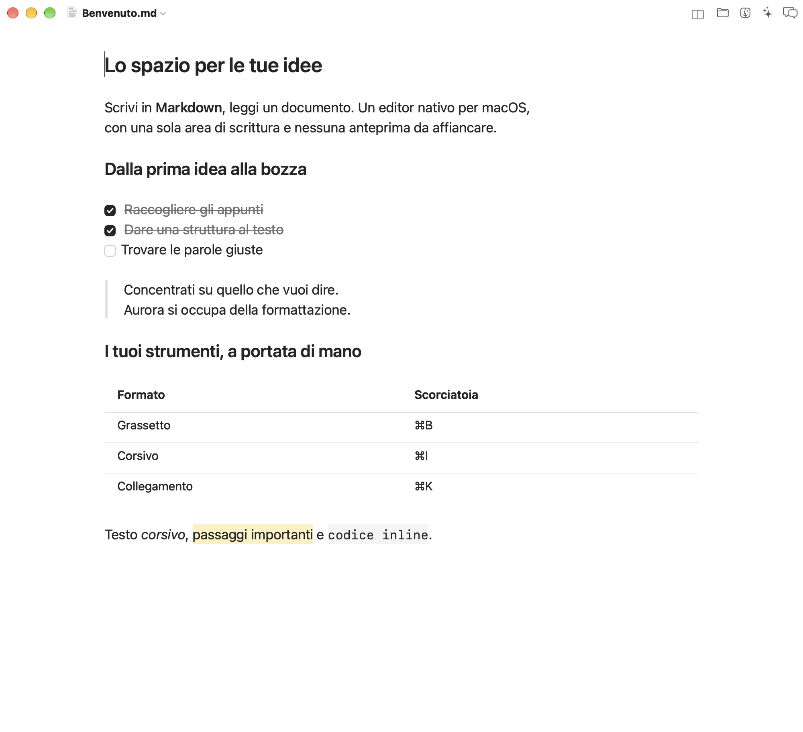
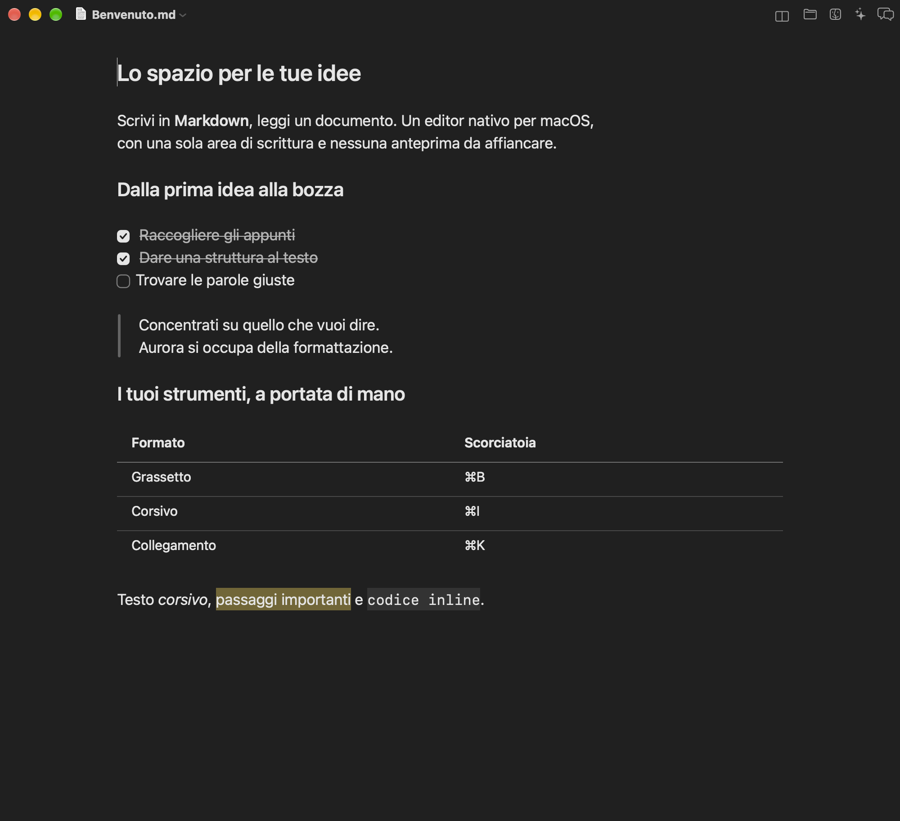
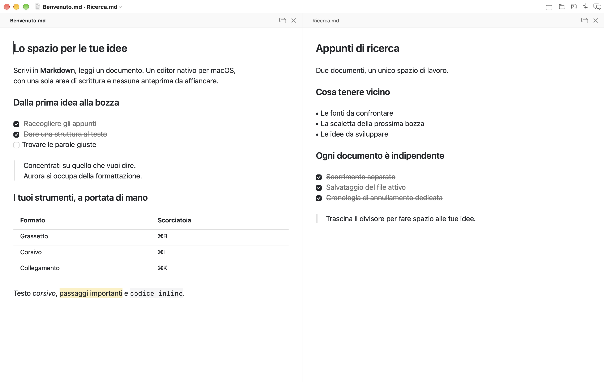

# Aurora

[](https://github.com/simo-ship-it/Aurora/actions/workflows/ci.yml)
[](LICENSE)

Editor Markdown nativo per macOS, scritto in Swift e AppKit. Come Typora, mostra il
testo già formattato **mentre lo scrivi**: non c'è un riquadro di anteprima separato,
c'è una sola area di scrittura in cui i marcatori Markdown restano sempre nascosti.
Le scorciatoie applicano e tolgono la formattazione senza mostrare la sintassi.

Il file su disco resta Markdown puro: nessun formato proprietario, nessuna conversione.

*[Read me in English](README.md)*

<p align="center">
  
</p>

<p align="center"><em>Il documento resta Markdown puro su disco, mentre
nell'editor si vede soltanto il risultato formattato.</em></p>

<p align="center">
  
</p>

<p align="center"><em>La stessa area di scrittura in modalità scura.</em></p>

<p align="center">
  
</p>

<p align="center"><em>Bozza e appunti di ricerca affiancati, con scorrimento,
salvataggio e annullamento indipendenti.</em></p>

## Installare

```bash
brew install simo-ship-it/aurora/aurora
```

Per aggiornare un’installazione esistente:

```bash
brew update
brew upgrade simo-ship-it/aurora/aurora
```

È una formula, non un cask: scarica il sorgente e compila Aurora sulla tua
macchina, cosa che richiede circa un minuto e i soli Command Line Tools di
Xcode. Il motivo è Gatekeeper. Aurora non è firmata con un Developer ID Apple —
serve un'iscrizione a pagamento — quindi una copia *scaricata* verrebbe messa in
quarantena e rifiutata al primo avvio. Una compilata sul posto non lo è mai.

A ogni [rilascio](https://github.com/simo-ship-it/Aurora/releases) è comunque
allegato uno `.zip`. Usandolo, macOS bloccherà l'app finché non togli tu il
contrassegno di quarantena:

```bash
xattr -dr com.apple.quarantine /Applications/Aurora.app
```

Serve macOS 13 o successivo.

## Compilare dai sorgenti

Servono solo i Command Line Tools di Xcode (niente Xcode completo).

```bash
./Scripts/build_app.sh
```

Lo script compila con SwiftPM e assembla `Aurora.app` nella cartella del progetto.
Poi basta aprirla:

```bash
open Aurora.app Esempio.md
```

Per lo sviluppo quotidiano è comodo anche `swift build` da solo, ma l'apertura dei
file dal Finder e il menu documenti funzionano solo eseguendo il bundle `.app`.

## Cosa supporta

| Elemento | Resa |
| --- | --- |
| Titoli `#` … `######`, Setext `===` / `---` | Sei livelli, con dimensioni dedicate |
| `**grassetto**`, `*corsivo*`, `***entrambi***` | Font reale, marcatori nascosti |
| `<u>sottolineato</u>` | Sottolineatura, tag nascosti |
| `~~barrato~~`, `==evidenziato==` | Barratura e sfondo giallo |
| `` `codice inline` `` | Font a spaziatura fissa con sfondo |
| Blocchi di codice recintati o rientrati | Riquadro grigio, delimitatori nascosti |
| Citazioni `>` (anche annidate) | Barra laterale e rientro per livello |
| Elenchi `-`, `*`, `+`, `1.`, `1)` | Pallini disegnati, rientri automatici |
| Task list `- [ ]` / `- [x]` | Casella cliccabile, voce completata barrata |
| Collegamenti inline, di riferimento e automatici | Colorati, apribili con un clic nel browser |
| Immagini `` | Anteprima locale o remota, sorgente Markdown preservata |
| `---`, `***`, `___` | Linea orizzontale disegnata |
| Tabelle `\| a \| b \|` | Celle modificabili, intestazione in grassetto, allineamenti e comandi per righe e colonne |

## Scrittura

- **Invio** continua l'elenco, la numerazione o la citazione della riga corrente;
  su un elemento vuoto esce dall'elenco.
- **Tab** e **⇧Tab** aumentano entrambi il rientro degli elementi. Per ridurlo si
  tolgono gli spazi a mano: è una scelta, non una dimenticanza.
- **⌘B**, **⌘I**, **⌘U**, **⇧⌘X**, **⇧⌘H** applicano e tolgono grassetto,
  corsivo, sottolineato, barrato ed evidenziato.
- **⌘1 … ⌘6** impostano il livello del titolo, **⌘0** torna a paragrafo.
- **⌘+** porta il paragrafo corrente attraverso H6 … H1; **⌘−** torna da H1
  attraverso H6 fino al paragrafo normale.
- **⇧⌘U** elenco puntato, **⇧⌘T** elenco di attività, **⌥⌘K** blocco di codice,
  **⌘K** collegamento. Elenchi numerati e immagini sono disponibili dal menu
  **Formato**.
- **/** apre il menu dei comandi (vedi sotto).
- **⌘F** cerca nel documento, con la barra di ricerca di sistema.
- Un clic su una casella `[ ]` la spunta; un clic su un collegamento lo apre nel browser predefinito.

Codice inline, citazione e linea orizzontale si prendono dal menu **Formato**: le loro
scorciatoie (⌘`, ⇧⌘', ⇧⌘-) sono dichiarate su tasti di punteggiatura che con layout
non statunitensi — l'italiano fra questi — stanno altrove, quindi non rispondono.

Annulla/ripristina, salvataggio automatico, versioni, documenti recenti e schede
delle finestre sono quelli standard di macOS.

## Menu dei comandi

Digitando **/** a inizio riga, o dopo uno spazio, si apre un elenco di tutti i comandi
di formattazione: titoli, elenchi, citazione, blocco di codice, linea orizzontale,
collegamento, immagine, grassetto, corsivo, barrato, evidenziato, codice inline.
Continuando a scrivere si filtra, **↑ ↓** scorrono, **Invio** o un clic applicano,
**Esc** chiude.
Il testo digitato dopo la barra sparisce insieme al menu.

Si filtra sul nome ma anche sulla sintassi: `/###` trova Titolo 3 e `/---` la linea
orizzontale, per chi il Markdown lo conosce già.

Dentro una parola la barra resta una barra — `http://esempio.it` e `e/o` non aprono
niente — e dentro un blocco di codice il menu non compare affatto.

Ogni voce richiama il comando che esiste già nel menu Formato: il menu dei comandi è
un modo per raggiungerli scrivendo, non una seconda implementazione.

## Cartella di lavoro

Il pulsante a forma di cartella in barra del titolo apre l'albero della cartella su cui
stai lavorando: le sottocartelle si aprono sul posto, i file si aprono con un clic.
Per sceglierne un'altra, **⌘⇧O** oppure un clic sul nome della cartella in cima al
pannello.
I pulsanti accanto aprono la stessa cartella nel Finder, in Claude Cowork o in ChatGPT.

Il menu delle azioni e il clic destro su un elemento permettono di creare cartelle,
rinominare, spostare, copiare, duplicare ed eliminare file o cartelle. Le modifiche
eseguite fuori da Aurora aggiornano automaticamente l’albero. All’avvio l’app
riapre anche l’ultimo documento.

I figli di una cartella si leggono dal disco solo quando la si apre, quindi un albero
profondo non costa nulla finché resta chiuso. La cartella scelta e quali sono aperte
sopravvivono alla chiusura dell'app. Se non ne hai ancora scelta una, il pannello
adotta la cartella del primo documento che apri.

Elenca solo `.md`, `.markdown`, `.mdown`, `.mkd`, `.mdtext` e `.txt`: serve a scrivere,
non a esplorare il disco. La prima volta che punti la cartella dentro Documenti,
Scrivania o Download, macOS chiede il permesso di accedervi.

## Due documenti affiancati

Usa **File → Apri affiancato…** (`⌘\`) oppure il pulsante di divisione nella
barra del titolo per scegliere il secondo documento. Puoi scegliere anche un
file già aperto: l’editor viene trasferito nello split conservando modifiche non
salvate e cronologia di annullamento.

Trascina il divisore per regolare le larghezze. I documenti scorrono e si
modificano in modo indipendente; **⌘S** salva quello in cui stai lavorando.
**Control-Tab** passa all’altro documento. Le intestazioni mostrano il nome di
ogni file e le modifiche non salvate. Il pulsante di chiusura in un’intestazione
chiude solo quel documento, dopo la verifica delle modifiche.
**Vista → Separa documenti**, oppure il pulsante per la finestra separata in
un’intestazione, torna a due finestre. Chiudere tutta la finestra verifica
entrambi i documenti prima di chiuderli.

## Impostazioni

**⌘,** apre le impostazioni: carattere, dimensione del testo, interlinea,
larghezza della colonna, e se l'app segua l'aspetto di sistema o resti chiara o
scura. I cursori mostrano il valore mentre li trascini ma lo applicano solo
quando lasci il mouse: ogni cambiamento ridisegna tutti i documenti aperti, e
farlo a ogni scatto renderebbe il trascinamento a scatti sui file lunghi.

L'editor usa sempre una colonna di lettura centrata. Tieni premuto **⌥ Option**
per mostrare le due guide laterali, poi trascinane una: entrambi i lati si
spostano in modo simmetrico. La larghezza scelta viene salvata automaticamente
e resta disponibile anche nelle impostazioni.

Per una regolazione immediata mentre scrivi, scegli **Vista → Aumenta dimensione
testo** (**⇧⌘+**) o **Riduci dimensione testo** (**⇧⌘−**). Il comando nel menu
ripristina la dimensione predefinita.

Il carattere predefinito è quello di sistema, che non è una famiglia fra le
altre: segue la dimensione ottica e le impostazioni di accessibilità. Il codice
resta monospaziato qualunque cosa si scelga, perché allinearsi in colonna è
tutto il motivo per cui è monospaziato.

## Lingua

Aurora segue la lingua di sistema e ripiega sull'inglese. Include inglese,
italiano, spagnolo, francese, tedesco, portoghese brasiliano, giapponese e
cinese semplificato.

Le traduzioni stanno in una tabella sola, `Scripts/make_strings.py`, invece che
sparse in otto file: aggiungere una frase significa aggiungere una riga per
lingua, e una lingua che la dimentica viene colta da `Scripts/check_strings.py`,
che l'integrazione continua esegue a ogni push. La chiave è la frase inglese
stessa, così una voce non ancora tradotta compare in inglese invece di mostrare
un nome interno.

## Com'è fatto

```
Sources/AuroraCore/
  MarkdownParser.swift     analisi di blocchi e elementi inline (solo indici, nessuna copia)
  MarkdownEditing.swift    modifiche al testo che sono pura aritmetica di indici

Sources/Aurora/
  main.swift               avvio dell'applicazione
  AppDelegate.swift        menu e ciclo di vita
  Localization.swift       una sola ricerca, chiavi in inglese
  Settings.swift           preferenze, e l'unico punto in cui il tema viene costruito
  SettingsWindowController.swift  la finestra Impostazioni
  MarkdownDocument.swift   NSDocument: lettura e scrittura UTF-8
  EditorViewController.swift  area di scrittura, colonna centrata, scorrimento
  MarkdownTextView.swift   NSTextView: glifi nascosti, decorazioni, comandi di editing
  MarkdownStyler.swift     dal risultato dell'analisi agli attributi del testo
  SlashMenu.swift          il menu dei comandi che si apre con "/"
  InlineTableView.swift    celle modificabili e comandi per righe e colonne
  TableLayout.swift        misure e allineamenti delle tabelle
  DocumentWindowController.swift  finestre con documenti singoli e affiancati
  ColumnWidthOverlayView.swift  guide trascinabili della colonna di lettura
  FileChangeObserver.swift  modifiche esterne a documenti e cartelle
  WorkspaceFileOperations.swift  gestione dei file e annullamento
  ChatGPTLauncher.swift    apertura della cartella di lavoro in ChatGPT
  Workspace.swift          cartella di lavoro e stato dell'albero, su UserDefaults
  WorkspaceBrowser.swift   pulsante in barra del titolo e albero dei file
  Theme.swift              font, colori chiari/scuri, metriche

Sources/AuroraCheck/       le prove (vedi sotto)
```

`AuroraCore` è un modulo a sé e importa solo Foundation. Il confine non è
burocrazia: è il modo in cui il compilatore tiene fede a quello che il parser
promette — leggere il testo, restituire indici, non sapere nulla di font, colori
o viste. È anche ciò che lo rende verificabile da solo.

Il punto delicato è nascondere la sintassi senza toccare il testo. Aurora usa lo
stack TextKit 1 e, tramite il delegato del layout manager, tratta i caratteri
marcati con un attributo interno come controlli a larghezza zero: i marcatori
restano nel documento e nella propria riga ma non occupano spazio. Quando la
selezione entra in una riga, la resa non cambia: i marcatori restano invisibili.

Per restare fluido su file grandi, lo stile non viene ricalcolato ovunque a ogni
tasto: si aggiornano le righe modificate e quelle che compaiono scorrendo. L'unico
caso in cui serve andare oltre è l'apertura
o la chiusura di un blocco di codice, che cambia l'aspetto di tutto ciò che segue: lo
styler se ne accorge confrontando lo stato dei blocchi prima e dopo la modifica.

Le decorazioni disegnate — il riquadro del codice, la barra delle citazioni, la
linea orizzontale, i segni di elenco — non dipendono dal rettangolo di un carattere
nascosto, che avendo larghezza zero non è un'ancora geometrica utile. Si enumerano
invece i frammenti di riga inquadrati e si incrociano con gli intervalli di caratteri:
ogni decorazione resta così legata alla propria riga.

Le tabelle usano celle native modificabili sopra la sorgente Markdown nascosta.
Modificare una cella o aggiungere e rimuovere righe e colonne aggiorna la tabella
Markdown sottostante e partecipa alla cronologia di annullamento del documento.
Il file su disco resta Markdown puro.

C'è poi una regola che tiene fermo il testo mentre lo scrivi: **la geometria verticale
di una riga non dipende dal cursore, e le righe di solo testo non aggiungono spazio
sopra o sotto di sé**. La separazione la danno le righe vuote — che in Markdown sono
anche il modo in cui la separazione è scritta nel file. Fanno eccezione, volutamente,
le anteprime delle immagini, che riservano sotto la sorgente l'altezza necessaria.
`paragraphStyle` non riceve lo stato di selezione, quindi la geometria non cambia
quando il cursore entra o esce dalla riga.

## Prove

```bash
swift run AuroraCheck
python3 Scripts/check_app.py
```

Le prove sono un eseguibile invece che un target di test perché XCTest e
swift-testing arrivano con Xcode, mentre per compilare Aurora bastano i Command
Line Tools: legarle a Xcode significherebbe che sulla macchina di chi sviluppa
l'app non girano. Coprono il parser — titoli, elenchi, caselle, citazioni,
blocchi di codice, tabelle, collegamenti, immagini, estremi del documento — e
l'aritmetica di indici dietro ai comandi di modifica.

`check_app.py` verifica anche le finestre AppKit e lo split: salvataggio,
annullamento indipendente, immagini relative, trasferimento tra finestre e
annullamento di una chiusura con modifiche non salvate. Richiede una sessione
macOS con desktop attivo. Usa un identificativo dell’app, preferenze e file di
prova separati, dentro `.build/AppChecks`.

Per aggiornare le schermate dei README dalle vere viste AppKit:

```bash
python3 Scripts/capture_screenshots.py
```

Lo script acquisisce finestre in inglese e italiano, in modalità chiara, scura e
affiancata, usando un identificativo dell’app, preferenze e documenti di esempio
separati.

## Limiti attuali

- Nessuna evidenziazione della sintassi dentro i blocchi di codice.
- HTML grezzo, note a piè di pagina, notazione matematica e diagrammi restano testo.
- Aprire un recinto ` ``` ` senza chiuderlo rende codice tutto il resto del documento,
  come vuole il Markdown: il testo sotto si riorganizza finché non lo chiudi.

## Difetti noti

- **⌘` , ⇧⌘' e ⇧⌘- non rispondono** con tastiere non statunitensi. I comandi
  funzionano dal menu Formato.

## Contribuire

Vedi [CONTRIBUTING.md](CONTRIBUTING.md). Segnalazioni e pull request sono
benvenute; i [modelli di issue](.github/ISSUE_TEMPLATE) chiedono le poche cose
che di solito contano davvero.

## Licenza

[MIT](LICENSE) © 2026 Simone Billeri.
