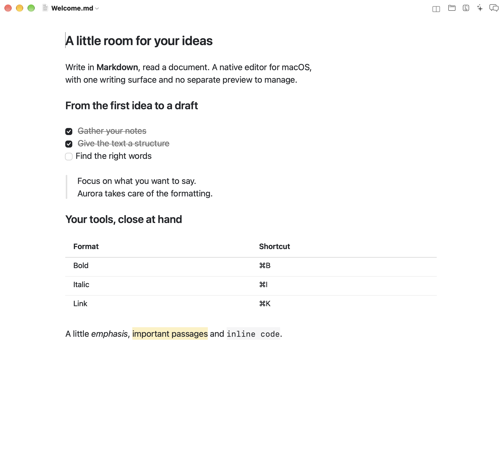
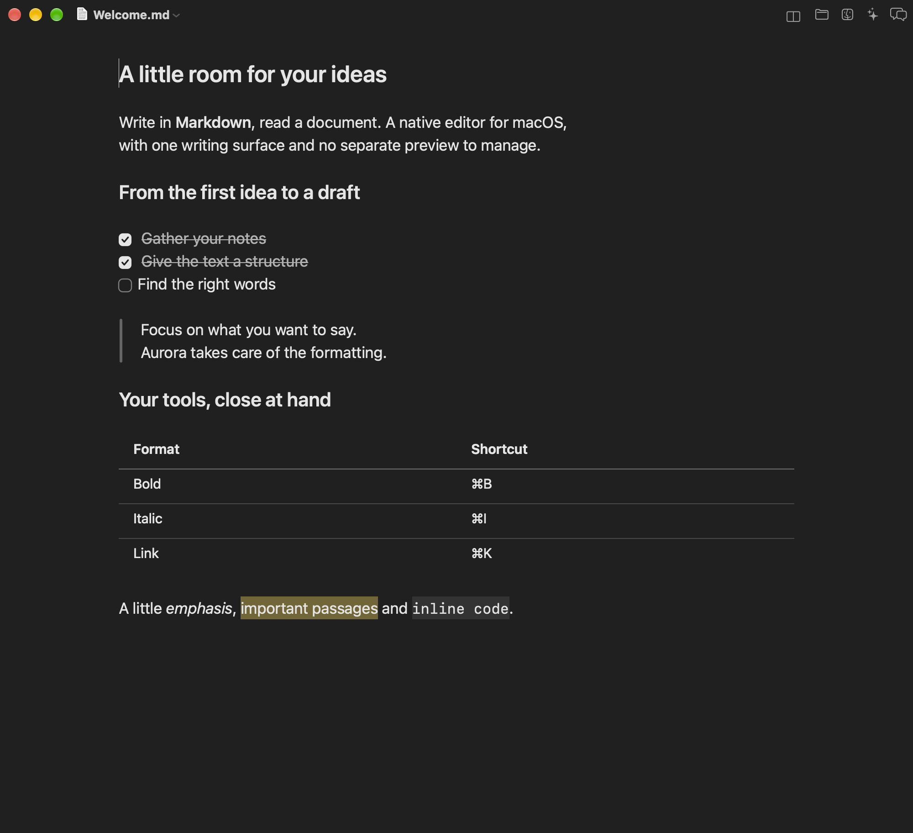
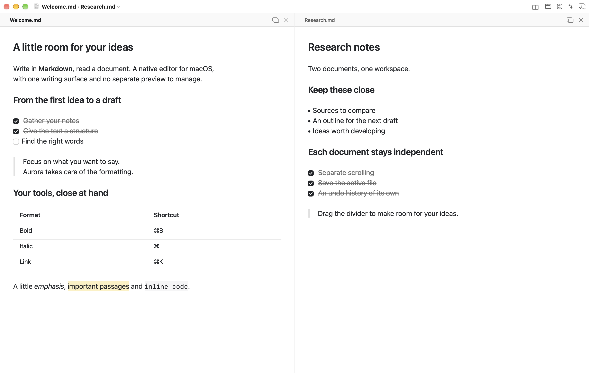

# Aurora

[](https://github.com/simo-ship-it/Aurora/actions/workflows/ci.yml)
[](LICENSE)

A native Markdown editor for macOS, written in Swift and AppKit. Like Typora, it
shows text already formatted **as you write it**: there is no separate preview
pane, just one writing surface where Markdown markers always stay hidden.
Keyboard shortcuts apply and remove formatting without exposing the syntax.

The file on disk stays plain Markdown: no proprietary format, no conversion.

*[Leggimi in italiano](README.it.md)*

<p align="center">
  
</p>

<p align="center"><em>The document remains plain Markdown on disk, while the
editor only shows the formatted result.</em></p>

<p align="center">
  
</p>

<p align="center"><em>The same writing surface in dark mode.</em></p>

<p align="center">
  
</p>

<p align="center"><em>Keep a draft and research notes side by side, with
independent scrolling, saving and undo.</em></p>

## Install

```bash
brew install simo-ship-it/aurora/aurora
```

To update an existing installation:

```bash
brew update
brew upgrade simo-ship-it/aurora/aurora
```

That is a formula, not a cask: it fetches the source and builds Aurora on your
own machine, which takes about a minute and needs only Xcode's Command Line
Tools. The reason is Gatekeeper. Aurora is not signed with an Apple Developer
ID — that requires a paid membership — so a *downloaded* copy would be
quarantined and refused at first launch. Something compiled locally never is.

A `.zip` is attached to every [release](https://github.com/simo-ship-it/Aurora/releases)
as well. If you use it, macOS will block the app until you clear the quarantine
flag yourself:

```bash
xattr -dr com.apple.quarantine /Applications/Aurora.app
```

Requires macOS 13 or later.

## Build from source

Only Xcode's Command Line Tools are needed — not the full Xcode.

```bash
./Scripts/build_app.sh
```

The script compiles with SwiftPM and assembles `Aurora.app` in the project
folder. Then just open it:

```bash
open Aurora.app Esempio.md
```

For everyday development `swift build` alone is convenient too, but opening
files from Finder and the document menus only work when running the `.app`
bundle.

## What it supports

| Element | Rendering |
| --- | --- |
| Headings `#` … `######`, Setext `===` / `---` | Six levels, each with its own size |
| `**bold**`, `*italic*`, `***both***` | Real font, markers hidden |
| `<u>underline</u>` | Underlined text, tags hidden |
| `~~strikethrough~~`, `==highlight==` | Struck through, yellow background |
| `` `inline code` `` | Monospaced with a background |
| Fenced and four-space code blocks | Grey surface, fence lines hidden |
| Blockquotes `>` (nested too) | Side bar and indent per level |
| Lists `-`, `*`, `+`, `1.`, `1)` | Drawn bullets, automatic indents |
| Task lists `- [ ]` / `- [x]` | Clickable box, completed item struck through |
| Inline, reference and bare links | Coloured link, click to open in the browser |
| Images `` | Local or remote preview, Markdown source preserved |
| `---`, `***`, `___` | Drawn horizontal rule |
| Tables `\| a \| b \|` | Editable cells, bold header, alignment and row/column controls |

## Writing

- **Return** continues the list, the numbering or the blockquote of the current
  line; on an empty item it leaves the list.
- **Tab** and **⇧Tab** both increase the indent of list items. To decrease it
  you remove the spaces by hand: that is a choice, not an oversight.
- **⌘B**, **⌘I**, **⌘U**, **⇧⌘X**, **⇧⌘H** apply and remove bold, italic,
  underline, strikethrough and highlight.
- **⌘1 … ⌘6** set the heading level, **⌘0** returns to paragraph.
- **⌘+** promotes the current paragraph through H6 … H1; **⌘−** moves back
  through H1 … H6 to a normal paragraph.
- **⇧⌘U** bulleted list, **⇧⌘T** task list, **⌥⌘K** code block, **⌘K** link.
  Numbered lists and images are available from the **Format** menu.
- **/** opens the command menu (see below).
- **⌘F** searches the document, using the system find bar.
- Clicking a `[ ]` box ticks it; clicking a link opens it in the default browser.

Inline code, blockquote and horizontal rule are reached from the **Format**
menu: their shortcuts (⌘`, ⇧⌘', ⇧⌘-) are declared on punctuation keys that sit
elsewhere on non-US layouts — Italian among them — so they do not respond.

Undo/redo, autosave, versions, recent documents and window tabs are the standard
macOS ones.

## Command menu

Typing **/** at the start of a line, or after a space, opens a list of every
formatting command: headings, lists, blockquote, code block, horizontal rule,
link, image, bold, italic, strikethrough, highlight, inline code. Typing on
filters the list, **↑ ↓** move through it, **Return** or a click applies, **Esc** dismisses.
Whatever you typed after the slash disappears along with the menu.

Filtering matches the name but also the syntax: `/###` finds Heading 3 and
`/---` the horizontal rule, for those who already know Markdown.

Inside a word a slash stays a slash — `http://example.com` and `and/or` open
nothing — and inside a code block the menu does not appear at all.

Every entry calls the command that already exists in the Format menu: the
command menu is a way to reach them by typing, not a second implementation.

## Working folder

The folder button in the title bar opens the tree of the folder you are working
in: subfolders expand in place, files open with one click. To pick another one,
**⌘⇧O** or a click on the folder name at the top of the panel.
The adjacent buttons open that folder in Finder, Claude Cowork, or ChatGPT.

The actions menu and a right click on an item let you create folders, rename,
move, copy, duplicate and delete files or folders. Changes made outside Aurora
refresh the tree automatically. Aurora also reopens your last document at launch.

A folder's children are read from disk only when it is expanded, so a deep tree
costs nothing while it stays closed. The chosen folder and which ones are open
survive quitting the app. If you have not chosen one yet, the panel adopts the
folder of the first document you open.

It lists only `.md`, `.markdown`, `.mdown`, `.mkd`, `.mdtext` and `.txt`: it is
there to write, not to browse the disk. The first time you point it inside
Documents, Desktop or Downloads, macOS asks for permission to read them.

## Two documents side by side

Use **File → Open Side by Side…** (`⌘\`) or the split button in the title
bar to choose a second document. You can also choose a file that is already open:
its editor moves into the split with its unsaved changes and undo history intact.

Drag the divider to adjust the widths. Each document scrolls and edits
independently; **⌘S** saves the document you are working in. **Control-Tab** moves
the focus to the other document. The headers show each file's name and unsaved
changes. Their close buttons close just that document after reviewing changes.
**View → Separate Documents**, or the separate-window button in a header, returns
to two windows. Closing the whole split reviews both documents before closing.

## Settings

**⌘,** opens Settings: typeface, text size, line spacing, column width, and
whether the app follows the system appearance or stays light or dark. The
sliders show the value while you drag them but only commit when you let go —
every change restyles every open document, and doing that on each notch of the
slider would make the drag stutter on long files.

The editor always uses a centered reading column. Hold **⌥ Option** to reveal
its two side guides, then drag either one to resize both sides symmetrically.
The chosen width is saved automatically and is still available in Settings.

For a quick adjustment while writing, choose **View → Increase Text Size**
(**⇧⌘+**) or **Decrease Text Size** (**⇧⌘−**). The menu command restores the
default size.

The default typeface is the system one, which is not just one family among the
others: it follows optical sizing and the accessibility settings. Code stays
monospaced whatever you choose, because lining up in columns is the whole reason
it is monospaced.

## Language

Aurora follows the system language, and falls back to English. It ships with
English, Italian, Spanish, French, German, Brazilian Portuguese, Japanese and
Simplified Chinese.

Translations live in one table, `Scripts/make_strings.py`, rather than scattered
across eight files: adding a phrase means adding one line per language, and a
language that forgets it is caught by `Scripts/check_strings.py`, which CI runs
on every push. The key is the English sentence itself, so a string that has not
been translated yet shows up in English instead of exposing an internal name.

## How it is built

```
Sources/AuroraCore/
  MarkdownParser.swift     block and inline analysis (indices only, no copying)
  MarkdownEditing.swift    text edits that are pure index arithmetic

Sources/Aurora/
  main.swift               application startup
  AppDelegate.swift        menus and life cycle
  Localization.swift       one lookup, English keys
  Settings.swift           preferences, and the only place the theme is built
  SettingsWindowController.swift  the Settings window
  MarkdownDocument.swift   NSDocument: UTF-8 reading and writing
  EditorViewController.swift  writing area, centred column, scrolling
  MarkdownTextView.swift   NSTextView: hidden glyphs, decorations, editing commands
  MarkdownStyler.swift     from the analysis to the text attributes
  SlashMenu.swift          the command menu that opens with "/"
  InlineTableView.swift    editable table cells and row/column controls
  TableLayout.swift        table measurements and alignments
  DocumentWindowController.swift  single and side-by-side document windows
  ColumnWidthOverlayView.swift  draggable reading-column guides
  FileChangeObserver.swift  external document and folder changes
  WorkspaceFileOperations.swift  file management and undo
  ChatGPTLauncher.swift    open the working folder in ChatGPT
  Workspace.swift          working folder and tree state, on UserDefaults
  WorkspaceBrowser.swift   title bar button and file tree
  Theme.swift              fonts, light/dark colours, metrics

Sources/AuroraCheck/       the tests (see below)
```

`AuroraCore` is a module of its own, and imports only Foundation. That boundary
is not bureaucracy: it is how the compiler holds the parser to what it promises —
read the text, return indices, know nothing about fonts, colours or views. It is
also what makes it testable on its own.

The delicate part is hiding the syntax without touching the text. Aurora uses
the TextKit 1 stack and, through the layout manager delegate, treats characters
carrying an internal attribute as zero-width controls: the markers stay in the
document and in their own line but take up no space. When the selection enters
a line, the rendering does not change: the markers remain invisible.

To stay fluid on large files, styling is not recomputed everywhere on every
keystroke: it updates the lines that changed and those appearing as you scroll.
The only case that needs more is
opening or closing a code fence, which changes the look of everything that
follows: the styler notices by comparing the fence state before and after the
edit.

The drawn decorations — the code surface, the quote bar, the horizontal rule,
the list markers — do not depend on the rectangle of a hidden character, which
has zero width and therefore provides no useful geometric anchor. Instead the
visible line fragments are enumerated and matched with character ranges, keeping
every decoration attached to its own line.

Tables use native editable cells over their hidden Markdown source. Editing a
cell or adding and removing rows and columns updates the underlying Markdown
table and participates in the document's undo history. The file on disk stays
plain Markdown.

Then there is a rule that keeps the text still while you write: **a line's
vertical geometry does not depend on the cursor, and text-only lines add no
space above or below themselves**. Separation comes from blank lines — which in
Markdown are also how separation is written in the file. Image previews are the
deliberate exception: they reserve their rendered height below the source line.
`paragraphStyle` is not given the selection state, so this geometry never changes
just because the cursor enters or leaves a line.

## Tests

```bash
swift run AuroraCheck
python3 Scripts/check_app.py
```

The tests are an executable rather than a test target because XCTest and
swift-testing ship with Xcode, while building Aurora needs only the Command Line
Tools: tying the tests to Xcode would mean they do not run on the machine where
the app is developed. They cover the parser — headings, lists, task boxes,
blockquotes, code blocks, tables, links and images, document edges — and the index
arithmetic behind the editing commands.

`check_app.py` also checks the AppKit document windows and split view, including
saving, independent undo, relative images, moving documents between windows, and
canceling a close with unsaved changes. Run it in a logged-in macOS desktop
session. It uses a separate app identifier, preferences and fixture files under
`.build/AppChecks`.

To refresh the README screenshots from the real AppKit views:

```bash
python3 Scripts/capture_screenshots.py
```

This captures English and Italian windows in light mode, dark mode and split
view, using a separate app identifier, preferences and sample documents.

## Current limits

- No syntax highlighting inside code blocks.
- Raw HTML, footnotes, mathematical notation and diagrams are left as text.
- Opening a ` ``` ` fence without closing it turns the rest of the document into
  code, as Markdown intends: the text below reflows until you close it.

## Known defects

- **⌘` , ⇧⌘' and ⇧⌘- do not respond** on non-US keyboards. The commands work
  from the Format menu.

## Contributing

See [CONTRIBUTING.md](CONTRIBUTING.md). Bug reports and pull requests are
welcome; the [issue templates](.github/ISSUE_TEMPLATE) ask for the few things
that usually turn out to matter.

## License

[MIT](LICENSE) © 2026 Simone Billeri.
